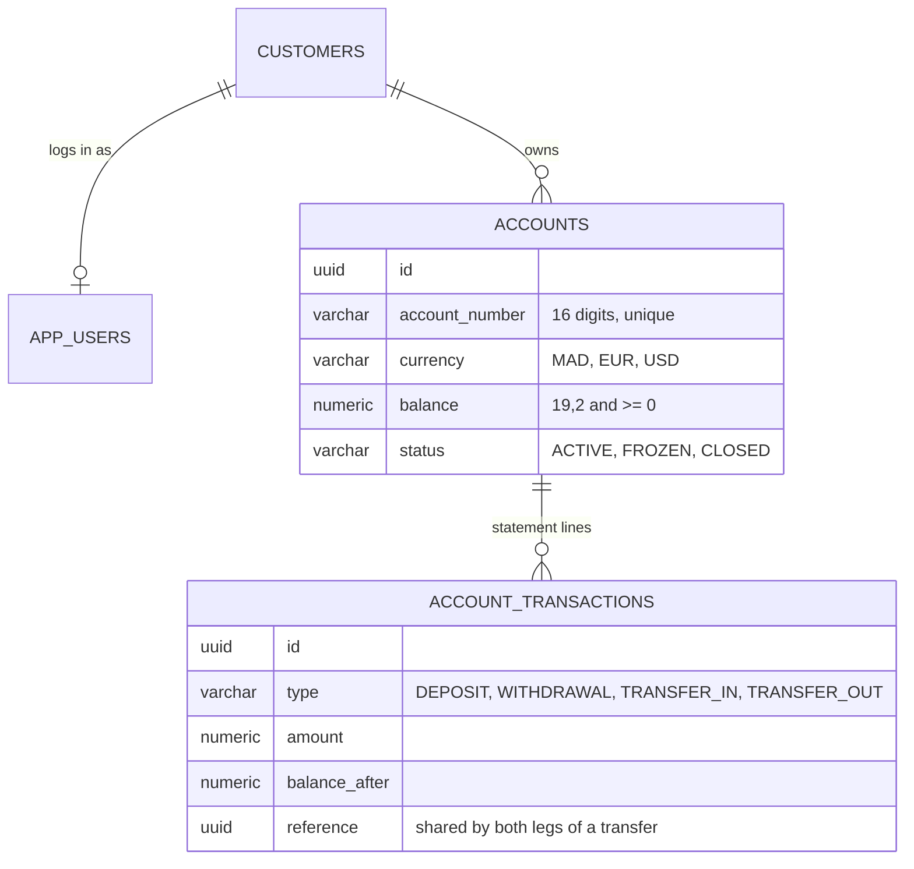

# corebank-api

A core banking API in Spring Boot 3 where concurrent transfers can never create or lose money.

[](https://github.com/Schaib03/corebank-api/actions/workflows/ci.yml)


It covers customers, accounts, deposits,
withdrawals, transfers and paginated statements, behind JWT authentication with USER and
ADMIN roles.

It is deliberately small in scope and strict on the parts that matter in banking: money
is never created or lost under concurrent requests, every movement leaves an immutable
trace, and errors are explicit.

## Architecture

```mermaid
flowchart LR
    client[Client] -- "Bearer JWT" --> sec
    subgraph app[corebank-api]
        sec[Security filter chain<br/>oauth2-resource-server] --> ctl[Controllers]
        ctl --> svc[Services<br/>@Transactional]
        svc --> repo[Spring Data JPA]
        act[Actuator :8081<br/>health, prometheus]
    end
    repo --> pg[(PostgreSQL)]
    fly[Flyway migrations] --> pg
    prom[Prometheus] --> act
```

```
src/main/java/com/saadchaib/corebank
├── auth/         register, login, AppUser, Role, admin bootstrap
├── security/     JWT issuing, CurrentUser, problem+json for 401/403
├── customer/     Customer entity and admin listing
├── account/      Account entity, open / get / freeze / close
├── transaction/  deposits, withdrawals, transfers, history
├── common/       exceptions, ProblemDetail handler, PageResponse
└── config/       security, OpenAPI, MVC wiring
```

Data model:



## Running it

With Docker:

```bash
docker compose up --build
```

API on http://localhost:8080, Swagger UI on http://localhost:8080/swagger-ui.html,
actuator on http://localhost:8081/actuator/health. Compose also creates an admin
(`admin@corebank.local` / `admin12345`).

Without Docker you need JDK 21 and a PostgreSQL database (defaults:
`jdbc:postgresql://localhost:5432/corebank`, user and password `corebank`):

```bash
./mvnw spring-boot:run
```

Tests:

```bash
./mvnw verify          # unit tests (*Test) then integration tests (*IT) on H2
```

CI runs the same suite twice, once on H2 and once on PostgreSQL 16 (by setting
`SPRING_DATASOURCE_URL`), so the Flyway migrations and the row locks are exercised on the
real database too.

## Configuration

| Variable | Default | |
| --- | --- | --- |
| `DATABASE_URL` | `jdbc:postgresql://localhost:5432/corebank` | JDBC URL |
| `DATABASE_USERNAME` / `DATABASE_PASSWORD` | `corebank` | |
| `JWT_SECRET` | dev value | HS256 key, at least 32 bytes. The app refuses to start otherwise. |
| `JWT_TTL` | `PT1H` | Token lifetime (ISO-8601 duration) |
| `ADMIN_EMAIL` / `ADMIN_PASSWORD` | empty | Creates the first admin at startup |
| `MANAGEMENT_PORT` | same as the API | Set to `8081` to keep actuator off the public port |

## API overview

| Method | Path | Role | |
| --- | --- | --- | --- |
| POST | `/api/auth/register` | public | Creates a customer and its login, returns a token |
| POST | `/api/auth/login` | public | Returns `{accessToken, tokenType, expiresAt}` |
| GET | `/api/me` | USER | Own profile |
| POST | `/api/accounts` | USER | Open an account `{type, currency}` |
| GET | `/api/accounts` | USER | Own accounts |
| GET | `/api/accounts/{id}` | USER, ADMIN | |
| POST | `/api/accounts/{id}/deposits` | USER, ADMIN | `{amount, description}` |
| POST | `/api/accounts/{id}/withdrawals` | USER, ADMIN | |
| POST | `/api/transfers` | USER, ADMIN | `{fromAccountId, toAccountNumber, amount, description}` |
| GET | `/api/accounts/{id}/transactions` | USER, ADMIN | `?page=0&size=20&type=DEPOSIT` |
| GET | `/api/admin/customers` | ADMIN | Paginated |
| GET | `/api/admin/customers/{id}` | ADMIN | |
| GET | `/api/admin/customers/{id}/accounts` | ADMIN | |
| PATCH | `/api/admin/accounts/{id}/status` | ADMIN | `{status: FROZEN | ACTIVE | CLOSED}` |

Example session:

```bash
TOKEN=$(curl -s localhost:8080/api/auth/register -H 'Content-Type: application/json' \
  -d '{"firstName":"Amal","lastName":"Bennani","email":"amal@example.ma","password":"password123"}' \
  | jq -r .accessToken)

ACC=$(curl -s localhost:8080/api/accounts -H "Authorization: Bearer $TOKEN" \
  -H 'Content-Type: application/json' -d '{"type":"CURRENT","currency":"MAD"}' | jq -r .id)

curl -s localhost:8080/api/accounts/$ACC/deposits -H "Authorization: Bearer $TOKEN" \
  -H 'Content-Type: application/json' -d '{"amount":"1500.00","description":"Salaire"}'
```

Errors use RFC 9457 problem details:

```json
{
  "type": "https://corebank.local/problems/insufficient-funds",
  "title": "Business rule violated",
  "status": 422,
  "detail": "Insufficient funds on account 7001482910374652.",
  "instance": "/api/accounts/3f6c.../withdrawals",
  "code": "insufficient-funds"
}
```

Validation errors (400) add an `errors` map of field to message. Missing or invalid
tokens give 401 with `WWW-Authenticate: Bearer`, wrong role gives 403, both in the same
format.

## Design decisions

**Pessimistic locking for money.** Every operation that changes a balance first loads the
account with `SELECT ... FOR UPDATE` (`AccountRepository.findByIdForUpdate`). A second
request on the same account waits until the first commits, then reads the new balance.
Optimistic locking (`@Version`) would also be correct, but under contention it turns into
failed requests the client has to retry. For a balance, waiting a few milliseconds is the
better trade. The lock has a 5 s timeout so a stuck transaction cannot block forever.

**Transfers lock in a fixed order.** A transfer locks two rows. If A→B locks A then B
while B→A locks B then A, the two can deadlock. `TransactionService.transfer` always locks
the account with the smaller id first, whatever the direction. `ConcurrencyIT` runs 20
opposing transfers on 8 threads to check it.

**Defense in depth on the balance.** Besides the service check, the database has
`CHECK (balance >= 0)`. If a bug ever skipped the check, the transaction would fail
instead of creating money.

**Statement lines are append-only.** `account_transactions` rows are never updated; each
stores `balance_after`, so a statement can be read without recomputing anything. Both legs
of a transfer share a `reference`, which is how you find the other side.

**BigDecimal, two decimals.** Amounts are `NUMERIC(19,2)` in the database and `BigDecimal`
in Java. Input with more than two decimals is rejected (`@Digits`) rather than silently
rounded. One currency per account; transfers between currencies are refused because there
is no FX in scope.

**JWT with HS256 and the resource server.** Login checks the bcrypt hash and issues a
token with `NimbusJwtEncoder` (subject = user id, `roles`, `customer_id`, 1 h expiry).
Spring Security's `oauth2-resource-server` validates the signature, expiry and issuer on
every request; no session is stored. A symmetric key is fine because the same service
issues and verifies tokens. With several services verifying tokens, I would switch to
RS256 and publish the public key (JWKS) so only the issuer holds the signing key.

**Not leaking information.** A customer asking for someone else's account gets 404, not
403, so account ids cannot be probed. Login with an unknown email still runs one bcrypt
comparison, so response time does not reveal which emails exist.

**Schema owned by Flyway.** Hibernate runs with `ddl-auto: validate`: it checks the
entities against the schema but never changes it. Every change is a versioned SQL file in
`db/migration`, applied in order at startup and recorded in `flyway_schema_history`.

**Actuator on its own port in Kubernetes.** With `MANAGEMENT_PORT=8081`, health and
metrics are reachable by the kubelet and Prometheus but are not routed by the ingress.

## Known limitations

- No refresh tokens or token revocation; a token is valid until it expires.
- No idempotency key on money endpoints. A client retrying a timed out transfer could
  send it twice. [payflow-api](https://github.com/Schaib03/payflow-api) shows how I would add it.
- No interest, fees or overdraft.

Kubernetes manifests: [gitops-platform](https://github.com/Schaib03/gitops-platform).
